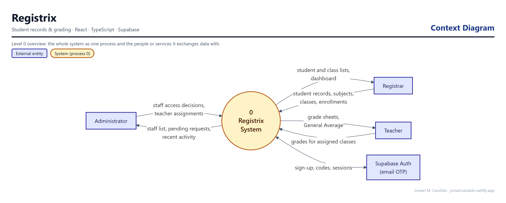
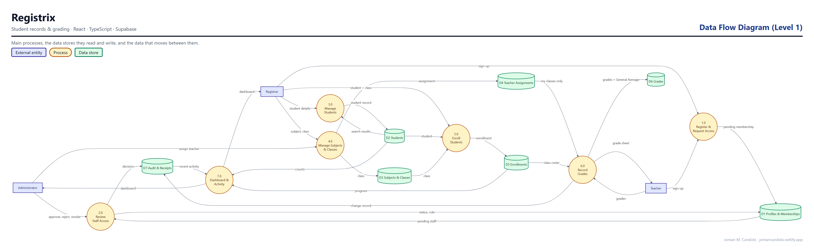
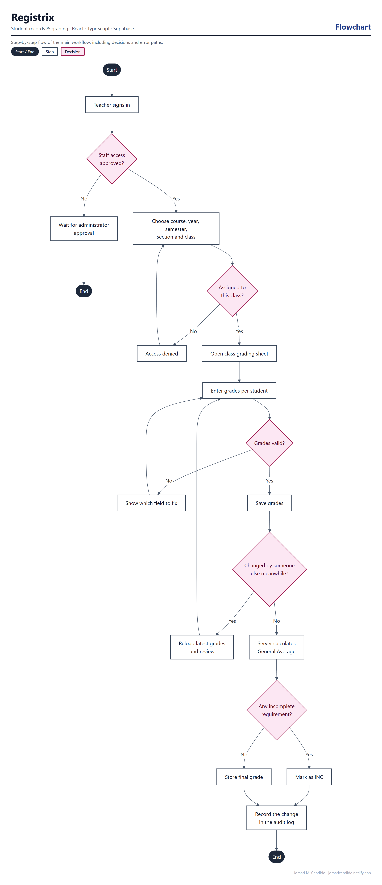

# Registrix

**Student Records & Grading System**

Registrix is a web-based student records and grading system, rebuilt from a C# Windows Forms and Microsoft Access desktop project. Administrators manage staff access and teacher assignments, registrars manage students, subjects, classes, and enrollments, and teachers grade only the classes assigned to them.

## Live Demo

**[Open Registrix](https://registrix.netlify.app/)**

## Highlights

- Email/password sign-in, registration, verification and resend, and password recovery
- New staff accounts stay pending until an administrator approves them
- Role-based access for administrators, registrars, and teachers
- One student can have multiple class enrollments, each with its own grades
- General Average calculated on the server; partial scores stay Incomplete and zero remains valid
- Archive and restore that keep history
- Stale edits are rejected, and interrupted saves recover without creating duplicates
- Responsive desktop, tablet, and mobile layout with accessible labels, dialogs, and keyboard controls

## System design

These diagrams were drawn from the app's actual database schema, roles and code paths.

**Context diagram.** Registrix as a single process, and the people and outside services it exchanges data with.



**Data flow diagram (Level 1).** The main processes, the data stores they read and write (grouped from the database tables), and the data that moves between them.



**Flowchart: teacher grading.** The main workflow step by step, including decisions and error paths.



## Tech Stack

- React, TypeScript, Vite
- Supabase Auth, PostgreSQL, Row Level Security, and RPC functions
- Vitest and the Playwright CLI
- Netlify

## Security Design

Every write goes through server-side RPC functions that check the caller's role: only administrators can approve staff or assign teachers, only administrators and registrars can manage records, and teachers can open and grade only their assigned classes. Saves carry a version check to reject stale edits, and each action is recorded in a private audit table.

> Only the Supabase project URL and publishable key are used in the browser. No legacy database, real student records, old passwords, or privileged credentials are included in this repository.

## Database

SQL migrations are in [`supabase/migrations/`](supabase/migrations/). Setup guides: [Supabase setup](docs/supabase-setup.md), [grade policy](docs/grade-policy.md), [database contracts](docs/database-contracts.md), and [catalog review](docs/catalog-review.md).

## Local Use

Use Node.js 24 or later.

```sh
npm ci
cp .env.example .env.local   # set the Supabase URL and publishable key
npm run dev
```

Open http://127.0.0.1:5190. `npm run build` creates `dist`.

## Testing

`npm test` runs 53 unit tests. `npm run test:db` runs database regression tests against a disposable local PostgreSQL cluster, and `npm run test:browser` runs Playwright CLI audits against real local SQL functions. `npm run typecheck`, `npm run check:assets`, and `npm run check:bundle` complete the checks. See [verification](docs/verification.md) and the [audit](AUDIT.md).

## Author

**Jomari M. Candido**
Sole Software Developer

## Project Status

Portfolio release — live on Netlify and deployed from this repository. Registrix is an independent academic portfolio project, not an official institution system.
